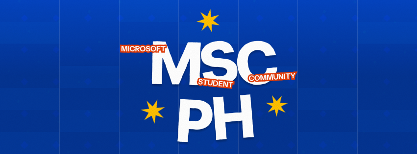

  

<h1 align="center">Microsoft Student Community Philippines</h1>

  

  
  
  
  

## About Microsoft Student Community Philippines

  <b>Microsoft Student Community Philippines (MSC PH)</b> is an <b>independent, student-led volunteer network</b>.
  We help Filipino students build in-demand Microsoft skills, become <b>Microsoft Student Ambassadors (MSA)</b>,
  and start tech communities on their own campuses. Our goal is to help every Filipino student <b>achieve more</b>,
  including those on campuses far from the country's major tech hubs.

### At a Glance

| | |
|:--|:--|
| **Name** | Microsoft Student Community Philippines |
| **Short name** | MSC PH |
| **Type** | Independent, student-led volunteer network |
| **Based in** | Philippines |
| **Who we serve** | Filipino students, including those on campuses far from the country's major tech hubs |
| **Membership** | Officers only. General membership is through local MSC chapters at universities. |
| **Focus areas** | Microsoft skills, the Microsoft Student Ambassadors (MSA) program, campus tech communities |
| **Events held** | 6 |
| **Official channels** | [Facebook](https://www.facebook.com/officialmscph) · [Instagram](https://www.instagram.com/officialmscph) · [LinkedIn](https://www.linkedin.com/company/officialmscph) · [GitHub](https://github.com/MSC-Philippines) |

## What We Do

<table align="center">
  <tr>
    <td align="center" width="33%" valign="top">
      <h3>Build Microsoft Skills</h3>
      Hands-on learning in in-demand Microsoft technologies such as Azure, AI, .NET, and GitHub.
    </td>
    <td align="center" width="33%" valign="top">
      <h3>Become a Microsoft Student Ambassador</h3>
      Guidance and mentorship for Filipino students joining the Microsoft Student Ambassadors (MSA) program.
    </td>
    <td align="center" width="33%" valign="top">
      <h3>Start Campus Tech Communities</h3>
      Support for students starting tech communities on their own campuses, even far from the major tech hubs.
    </td>
  </tr>
</table>

## Technologies We Focus On

  

## Our Events

| # | Event | Date | Venue | Repository |
|:-:|:------|:----:|:-----:|:----------:|
| 1 | **Microsoft Student Community Philippines Meetup I** | TBA | TBA |  |
| 2 | **Microsoft Build Localhost Manila 2026** | TBA | TBA |  |
| 3 | **Hello World!** | TBA | TBA |  |
| 4 | **Microsoft Student Community Philippines Meetup II** | TBA | TBA |  |
| 5 | **Microsoft Student Ambassadors 2026 Q3 Onboarding** | TBA | TBA |  |
| 6 | **.NET Conf Manila Local 2026** | TBA | TBA |  |

 

<table align="center">
  <tr>
    <td align="center">
      <h2>Wanna start a Microsoft Student Community at your university?</h2>
      

        We help students across the Philippines launch and grow tech communities on their own campuses, 
        from the first meetup to becoming Microsoft Student Ambassadors. Let's build yours together.
      

      
      
    </td>
  </tr>
</table>

## Frequently Asked Questions

<b>What is Microsoft Student Community Philippines (MSC PH)?</b>

 
Microsoft Student Community Philippines (MSC PH) is an independent, student-led volunteer network. It helps Filipino students build in-demand Microsoft skills, become Microsoft Student Ambassadors (MSA), and start tech communities on their own campuses.

<b>Who can join MSC PH?</b>

 
MSC PH serves Filipino students who want to grow in tech, including students on campuses far from the country's major tech hubs.
  
Please note that membership in MSC PH itself is for <b>officers only</b>. If you want to become a member of a Microsoft Student Community, check whether there is a local MSC chapter at your university and reach out to them for general membership. If your university doesn't have one yet, you can <a href="https://www.facebook.com/officialmscph">message us</a> about starting one.

<b>How can I become a Microsoft Student Ambassador in the Philippines?</b>

 
MSC PH guides Filipino students on their journey to the Microsoft Student Ambassadors (MSA) program through mentorship and sessions like the Microsoft Student Ambassadors 2026 Q3 Onboarding. Follow our <a href="https://www.facebook.com/officialmscph">Facebook</a> and <a href="https://www.linkedin.com/company/officialmscph">LinkedIn</a> pages for upcoming sessions.

<b>How do I start a Microsoft Student Community at my university?</b>

 
Message MSC PH on <a href="https://www.facebook.com/officialmscph">Facebook</a> or <a href="https://www.linkedin.com/company/officialmscph">LinkedIn</a>. We help students set up and grow tech communities on their own campuses anywhere in the Philippines.

<b>What events has MSC PH organized?</b>

 
MSC PH has organized Microsoft Student Community Philippines Meetup I, Microsoft Build Localhost Manila 2026, Hello World!, Microsoft Student Community Philippines Meetup II, Microsoft Student Ambassadors 2026 Q3 Onboarding, and .NET Conf Manila Local 2026. Each event has its own repository in this GitHub organization.
  
Aside from these MSC PH initiatives, local MSC chapters at universities across the Philippines also organize their own events. Reach out to the chapter at your university to find out what's coming up.

## Contributors

<table align="center">
  <tr>
    <td align="center">
      <a href="https://github.com/r0undy">
         
        <b>r0undy</b>
      </a>
    </td>
  </tr>
</table>

 

  <b>Achieve more. Be a force for good.</b> 
  This GitHub organization is maintained by the <b>Technology Department</b> of Microsoft Student Community Philippines (MSC PH).

